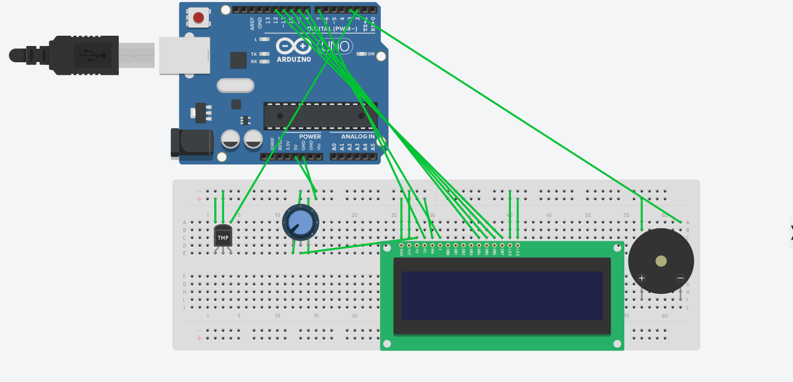

# Sense and Respond

> **Remove the instructions in block quotes before you submit.**

> Design, build, program, and test a system built using an Arduino that senses changes in a physical environment and responds automatically. Complete this README as you work. Keep your planning, testing evidence, and link to your video demo here.

## 1. System purpose

- **Problem and real-world context:** Greenhouses could get too hot or dry without you noticing. Greenhouse users need a way to alert them if their greenhouse gets to hot or dry.
- **Intended user:** Greenhouse users and other plant owners/users
- **What physical condition should your system monitor?** Temperature and moisture level of the greenhouse
- **How will the system's response help the user?** It will do an annoying beeping sound if the greenhouse temperature gets too hot or it gets too dry

## 2. System design

### System diagram

> Replace the TODOs with your own system details. Show what each sensor measures, how the Arduino uses the readings to choose a state, and how the LCD and additional output respond.

```text
Inputs (Temp and humidity) → Processing (checks if temp too high or moisture too low) → Outputs (Outputs a annoying beeping sound if there is a problem)
```

### Inputs and outputs

> Identify each sensor and output device. Add rows for additional devices.

| Device | Input or output | Arduino pin(s) | Analog or digital?  |
| --- | --- | --- | --- |
| DHT 11 | Sensor input | 2 | digital |
| LCD | Output | 6,7,8,9,10,11,12 | digital |
| Active buzzer | Additional output | 5 | digital |

### Decision table

> Plan at least two meaningful states that produce different responses based on sensor readings. Record the reading or condition that triggers each state. Record what sensor data the LCD displays and what the additional output (make sure to rename this to whatever the input is) does in each state.

| Sensor reading or condition | System state | LCD display | Additional output |
| --- | --- | --- | --- |
| Normal temp and humidity | Normal | humidity = >10% and temp = <80f | NA |
| humidity less than 10% or temp more than 80f| Uh-Oh bad | humidity = <10% or temp = >80f | Beeping noise |

### Libraries

> Identify each library your Arduino sketch uses and briefly explain what it helps the program do. Add rows as needed. If you used no libraries, write “None.”

| Library | What it does in your program |
| --- | --- |
| Liquid crystal | code for the LCD display screen |

## 3. Circuit design

> Upload a screenshot of your TinkerCAD circuit or a labeled circuit diagram. Show the components, Arduino pins, power, and ground connections. Replace the image path below if you use a different filename.



## 4. Testing and revision

> Test your working prototype under at least three different conditions. Include normal operation and at least two conditions that trigger a response. Record the condition or sensor reading for each test. Predict what the LCD and additional output will do, then record what you actually observe.

| Test | Condition or sensor reading | Expected response | Actual response |
| --- | --- | --- | --- |
| Normal operation | temp<75 and humidity >20 | stays silent | stays silent |
| Condition that triggers a response | temp >75 or humidity <20 | Beeps short | beeps short |
| Condition that triggers a response | temp >80 or humidity <15 | Beeps long | beeps long |

**Revisions made to the system based on testing**

> Describe any changes you made based on your test results and test the affected behavior again. If you made no changes, explain why.

**Revision and reason:** Added a second mode for if its way too hot or way too dry

**Result after testing the revision:** Theres now 3 modes total

## 5. Video Demonstration

> Replace the placeholder below with a link to your video. Introduce the real-world problem, show the sensor detecting a change in physical conditions, and demonstrate how the system responds under different conditions. Use on-screen text or voice-over to explain how it works. 

[Video demonstration](https://youtu.be/E91wwh8d3MU)
